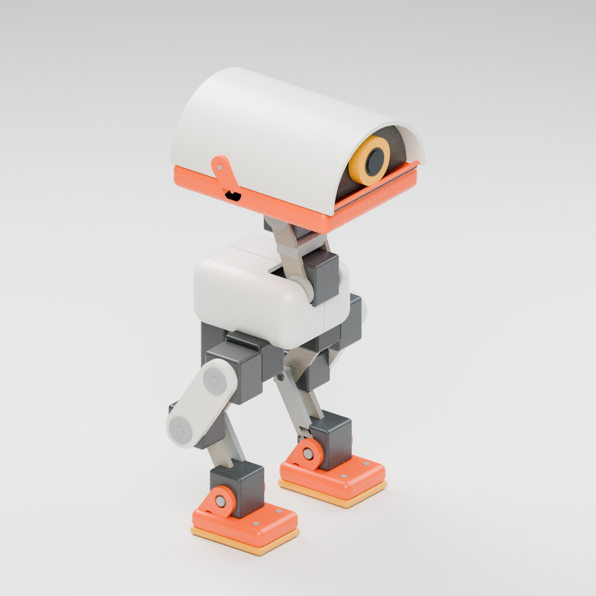

# MicroDuck CAD model

A solid CAD interpretation of Pollen Robotics' MicroDuck, plus a separate,
faithful mesh assembly from the official robot assets.



## Open the model

- **[microduck.step](exports/microduck.step)** — colored, named, 71-part solid
  assembly for FreeCAD, Fusion, Onshape, SolidWorks and other STEP-capable CAD.
- **[microduck.glb](exports/microduck.glb)** — colored 3D model for viewers and Blender.
- **[microduck.stl](exports/microduck.stl)** — assembled layout in millimeters.
- **[Individual part STLs](exports/parts/)** — separate closed solid meshes for
  print preparation or further modification.
- **[Parametric source](cad/microduck.py)** — editable CadQuery dimensions and geometry.
- **[Exact official mesh assembly](reference/microduck-reference-assembly.glb)** —
  a higher-detail visual reference, assembled from Pollen Robotics' original meshes.

The editable concept is approximately **274 mm tall × 135 mm wide × 122 mm
deep**. Its arched ivory head, single yellow-ringed camera, orange lower jaw,
exposed neck, articulated-looking legs and orange boots follow the reference.
The head and torso are hollow; joint straps have through-holes, and hardware,
camera, servos and body panels are separate solid parts.

This is a **visual CAD concept**. Servo envelopes and fasteners are simplified;
the assembly has no motion constraints, and dimensions, clearances and hardware
fits have not been validated for a working robot. The assembly STL contains
overlapping separate bodies. It is not a single watertight printable object.
Use the individual STLs to orient parts, add supports and prepare a print;
they do not include an engineered mounting or assembly system.

## Edit and regenerate

Python 3.12 and CadQuery 2.7.0 were used. Blender 4.3.2 was used for rendering.
From the existing checkout at `/workspace/groot-duck`:

```bash
python -m venv .venv
.venv/bin/python -m pip install -r requirements.txt
.venv/bin/python cad/microduck.py
```

If CadQuery is already installed, simply run `python cad/microduck.py`.
Edit `Parameters` in `cad/microduck.py` to change the head, shell thickness,
torso, feet or camera surround. All design dimensions are in millimeters;
axes are +X forward, +Y left and +Z up. STEP and STL retain millimeters; GLB
uses the standard glTF meter units and +Y up.

To make a half-size copy without replacing the main exports:

```bash
python cad/microduck.py --scale 0.5 --output exports/half-size
```

Export creates STEP, STL, GLB, per-part STLs and a manifest with dimensions,
volumes and part names. Re-render after geometry changes:

```bash
blender --background --python scripts/render_model.py -- --views all
```

Validate the actual exported STEP and STL files:

```bash
python scripts/validate_model.py
```

The validation report is saved in `exports/validation.json`. Rendered views
are in `exports/microduck_preview.png`, `exports/microduck_front.png` and
`exports/microduck_side.png`. `exports/microduck_studio.blend` contains the
colored concept assembly and its presentation scene.

## Reference and attribution

Original MicroDuck design and source meshes: **Pollen Robotics**.
The separate [reference package](reference/README.md) records source commits,
licenses, the original Onshape link and a reproducible assembly script.

- Product: <https://pollen-robotics.com/microduck>
- Official robot: <https://github.com/pollen-robotics/microduck>
- Official geometry: <https://github.com/pollen-robotics/microduck_rl>
- [Original Onshape CAD document](https://cad.onshape.com/documents/804927696f06d877f3f1803e/w/5b75db19292e71970de02dee/e/ef6e972847fec8d82570b35e)

The original mesh models and adapted geometry/renderings are licensed under
**[CC BY-NC-SA 4.0](https://creativecommons.org/licenses/by-nc-sa/4.0/)**.
This CAD concept is an adaptation recreated using solid primitives, elliptical
profiles, shell cuts and joint straps; it is not an export of the original
feature history. The reference assembly uses the unchanged official meshes,
posed and converted to export formats. See [LICENSE-MODEL.md](LICENSE-MODEL.md)
and the retained upstream [model license](reference/LICENSE-MODELS.md).

The exact mesh reference is 271.616 mm tall in its standing pose. That differs
from this simplified CAD concept and the official approximate 25 cm product
description. The original Onshape document was linked but not exported.

The two GitHub URLs in the request were truncated/combined, so no unidentified
repositories were used; the complete Pollen Robotics link identified the robot.
