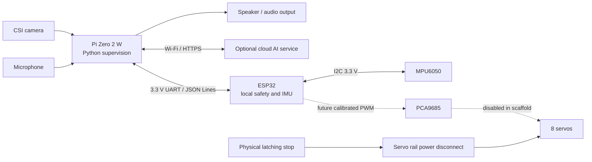

# Architecture and implementation boundaries

The first milestone is a simulated, testable command path and an electronics
bench with motor power disconnected. A finished walking robot is a later
research and mechanical engineering outcome.



## Responsibilities

| Component | Role | Current boundary |
|---|---|---|
| Pi Zero 2 W | Camera, voice, Wi-Fi, cloud requests and command supervision | Python package and simulation interfaces; production capture, speech and cloud providers are not commissioned |
| ESP32 | Bounded commands, local safety state, watchdog and IMU feedback | Firmware scaffold; hardware PWM output and runtime arming deliberately unavailable |
| MPU6050 | Raw acceleration/gyro observations | Raw sensor data is not a balance controller or calibrated attitude estimate |
| PCA9685 | Future eight-channel servo PWM | Planned hardware interface; no servo PWM writes in this scaffold |
| Physical stop and power gate | Independent removal of servo power | Must be installed and electrically tested before motor commissioning |
| Simulation backend | Exercise command limits and state behavior on a laptop | Kinematic command simulation, not contact, torque or physical balance simulation |

Cloud AI may propose high-level behavior. It must never write raw PWM, arm the
robot or bypass the local safety controller. Loss of Wi-Fi, an API timeout or
a Pi process failure cannot be allowed to leave an autonomous motor command
running. The local watchdog and independent power disconnect remain necessary.

## Command transport

The planned Pi-to-ESP32 wire format is newline-delimited JSON, protocol version
1, maximum 512 bytes before the newline, at 115200 baud. The Pi TX/RX signals
are 3.3 V UART, not RS-232 and not 5 V TTL. Each request carries `v`, `seq` and
`type`. Requests include `status`, `disarm`, `estop`, `target` and `arm`.
The initial firmware rejects `arm`; a commissioning implementation is required
before real output can ever be enabled. A `target` contains all eight named
`positions_deg` entries, and is not an instruction to start walking.

Example read-only request:

```json
{"v":1,"seq":1,"type":"status"}
```

Responses include protocol version, matching sequence when it can be decoded,
response type, safety state and `outputs_enabled`. Error details describe a
rejected command. Communication and sensor errors must not be represented as
successful motion. See the firmware README for the exact implemented response
fields and native safety-core tests.

## Configuration and calibration

`hardware/robot.json` describes the proposal, channel map, example simulation
envelopes and controller pins. All angles are degrees, dimensions are
millimeters, and the two knee simulation neutrals are 20 degrees. Those values
do not map directly to uncalibrated hobby-servo pulses. Physical directions,
horn positions, endpoints and mechanical neutral must be measured for each
individual servo and joint.

`hardware/calibration.example.json` intentionally contains `null` for pulse
endpoints, directions, neutral angles and mechanical limits. It must not be
treated as a usable calibration. All calibration and bench-approval flags are
false. The current firmware cannot load this file or authorize PWM from it.

## Camera, voice and cloud development

Start with a supported Raspberry Pi OS image and the Pi's built-in Wi-Fi. Use
a Zero-compatible narrow CSI camera cable. Prove camera capture independently
with the camera vendor's current Raspberry Pi documentation, then measure CPU,
memory and power consumption. A USB microphone, small audio amplifier/speaker
and an OTG adapter must share the Pi's limited power and USB resources.

The Zero 2 W is not assumed to run a large local language or speech model.
Cloud perception/voice can be added through provider interfaces with bounded
timeouts, cancellation and explicit user-controlled credentials. Keep API keys
outside Git and robot configuration; never put real credentials into examples.
Internet connectivity and paid API accounts are optional future integrations,
not prerequisites for the default simulation tests.

No camera, microphone, speaker, serial device, external AI service or physical
ESP32 board has been verified merely by running the simulation or compiling
firmware. Hardware acceptance is recorded separately during commissioning.
