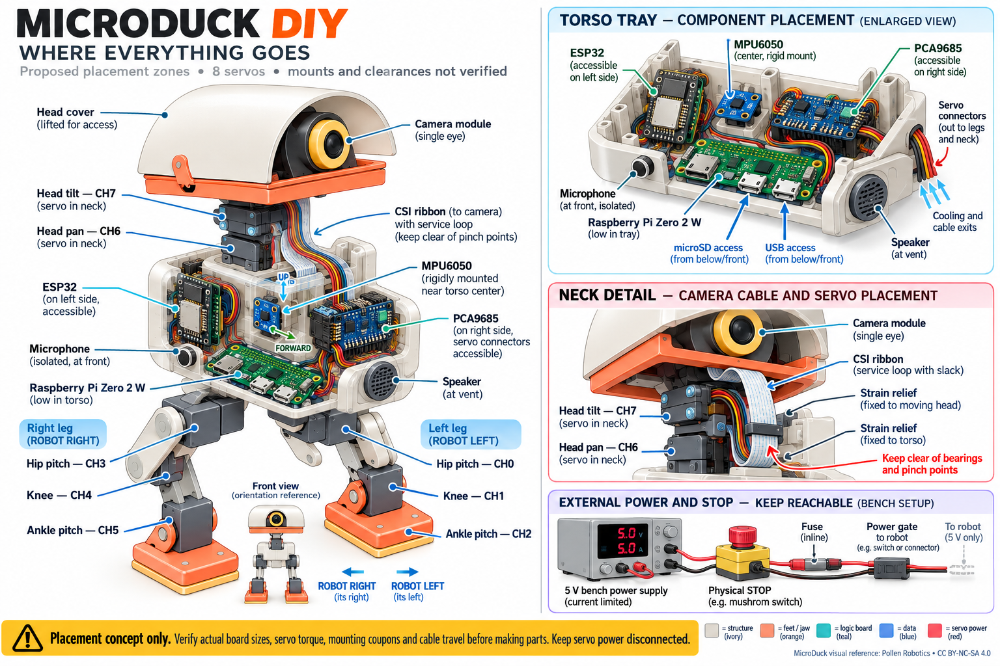
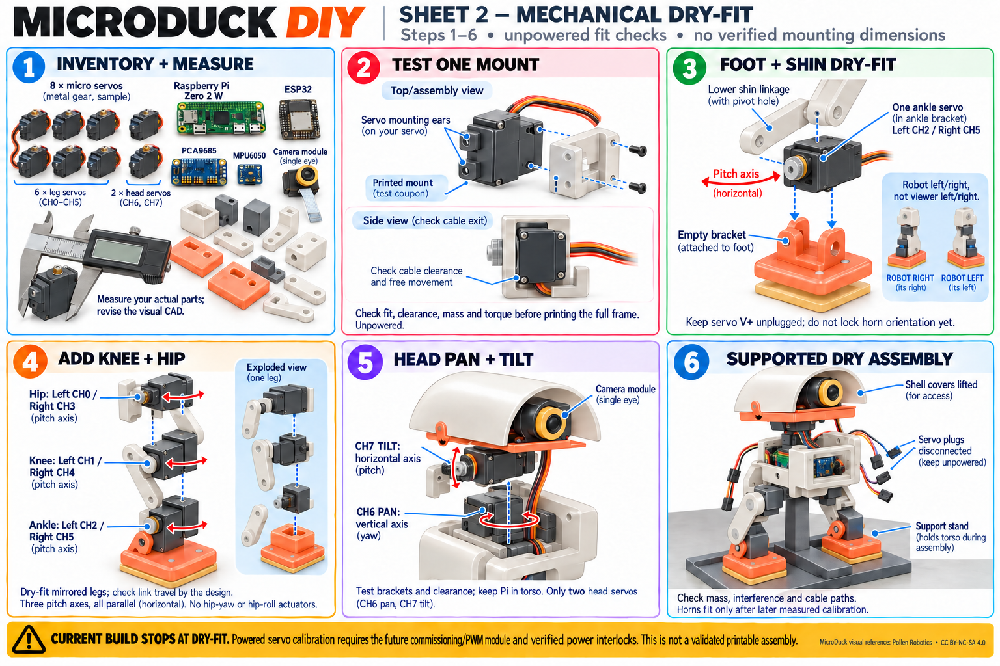
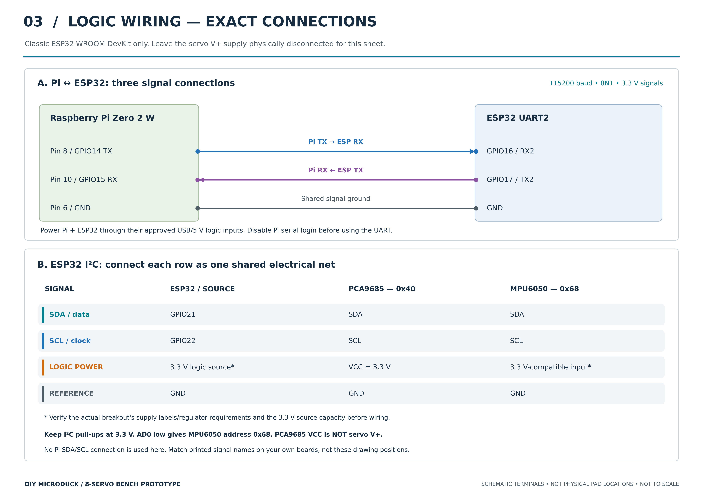
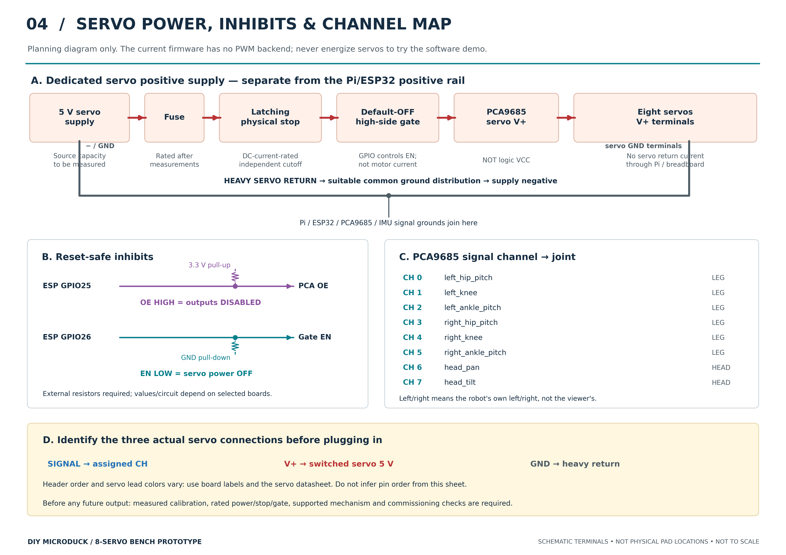

# Illustrated Microduck prototype build guide

Start with [the four-page printable guide](microduck-build-guide.pdf).
The [download ZIP](microduck-build-images.zip) includes full-resolution images,
the PDF guide, editable wiring diagrams and these notes.

| Sheet | What it shows | Open the image |
|---|---|---|
| 1 | Proposed locations of boards, camera, servos, audio and cable loops | [Component placement](01-component-placement.png) |
| 2 | Six unpowered mechanical fit-check steps, exploded joints and support stand | [Mechanical dry-fit](02-mechanical-dry-fit.png) |
| 3 | Exact UART and I²C signal connections, separate logic power | [Logic wiring](03-logic-wiring.png) |
| 4 | Servo power path, default-off controls and all eight servo channels | [Power and channels](04-servo-power-and-channels.png) |

**These are prototype planning and dry-fit instructions, not a validated kit.**
The existing CAD has not been redesigned for these eight servos. Mount holes,
brackets, board clearances, link lengths, total mass and torque must be checked
with actual parts. Do not print the archived CAD expecting these placements
or the illustrated brackets to fit. No balance or walking has been demonstrated.

## Image previews

Click an image or its link in the table above to inspect labels at full size.









## Where the parts go

- **Pi Zero 2 W:** low in the torso on insulated mounts; allow USB, microSD,
  antenna and cooling access. Keep its mass out of the moving head.
- **Camera:** behind the single head lens. Use a Zero-compatible CSI ribbon
  with protected slack for both head joints. Follow the cable's bend limits;
  keep it clear of bearings and pinch points and install with logic power off.
- **ESP32:** an accessible torso side, with USB and UART access.
- **PCA9685:** opposite side of the torso, with headers accessible to the leg
  and head cable exits. Its logic VCC and servo V+ are different supplies.
- **MPU6050:** rigidly fixed near the torso center. Record its measured axis
  orientation relative to the robot; no attitude estimate is implemented yet.
- **Speaker and microphone:** speaker by a torso vent; microphone isolated
  from the speaker and servo vibration.
- **Bench supply, fuse, physical stop and gate:** keep accessible externally
  during the prototype stage. No battery is included in this design/budget.

Left and right always mean the robot's own left and right. In a straight front
view, the robot's left appears on your right.

## Suggested build order

1. **Inventory and measure.** Identify the actual boards and eight servos;
   check the [BOM](../../hardware/bom.csv). Measure servo bodies, ears, horns
   and cable exits before changing CAD. Check mass and torque feasibility.
2. **Make one mounting coupon.** Prove that one servo fits the proposed bracket
   and that its cable clears. The illustration does not specify a hole pattern,
   screw size, bearing fit or load rating.
3. **Dry-fit the feet and shins.** One ankle servo per leg: left CH2, right CH5.
   Keep motor power disconnected and do not lock horn orientation yet.
4. **Dry-fit knees and hips.** Left hip/knee CH0/CH1, right hip/knee CH3/CH4.
   Each leg has three parallel pitch axes. There are no hip-roll/yaw servos.
5. **Dry-fit the two head axes.** CH6 pan rotates about a vertical axis; CH7
   tilt rotates about a horizontal axis. Put only the camera in the head.
6. **Support the torso and arrange electronics.** Use an external stand/fixture,
   check interference and route cables with protected slack and strain relief.
   Keep motor plugs and servo power disconnected. Validate the new mechanical
   design before a final assembly; the existing CAD is a visual reference.
7. **Wire and check logic only.** Follow sheet 3 and the actual board labels.
   Verify voltages, grounds, UART and IMU observations with servo V+ absent.
   Current firmware cannot enable PWM or authorize real motors.
8. **Verify power inhibition without servos.** Follow sheet 4 and check the
   physical stop, gate and OE behavior with a meter/appropriate dummy load.
   Select ratings from measured loads, not illustrated meter readings.
9. **Later commissioning milestone.** Implement and review the missing
   calibration/output module and meet every [commissioning gate](../commissioning.md).
   Only then calibrate individual unloaded servos, record their measured limits,
   set horn orientation and test an externally supported assembly. This guide
   does not provide generic pulse endpoints or instructions to bypass inhibition.

## Reading the drawings correctly

The rendered component-placement and mechanical images are illustrative.
Connector shapes, wire colors, screen readings, bracket geometry and screw
positions are not specifications. For electrical connections, **sheets 3 and 4
and the [wiring document](../wiring.md) are the source of truth**. Their terminal
locations are schematic, not literal physical PCB pin positions. Find each
signal label on the particular boards you own and verify it.

The current software supports joint interpolation and native safety tests. It
does not include a real PWM backend or calibrated motor mapping; changing a
configuration flag does not commission the robot. Balance research is a later
milestone and may require revising the pitch-only leg design.

## Formats, sources and regeneration

Sheets 1–2 are generated concept illustrations informed by the existing CAD;
the original image outputs are preserved separately in the execution workspace.
Sheets 3–4 are original vector drawings derived from `hardware/robot.json` and
the wiring/commissioning documentation. See [electrical source notes](wiring-notes.md).

With the optional document dependencies installed, run:

```bash
python -m pip install -r requirements-docs.txt
python scripts/render_build_wiring.py
python scripts/package_build_guide.py
```

The first command redraws the electrical diagrams. The second packages the
existing concept PNGs with the electrical PDFs; it does not regenerate CAD,
edit image pixels or actuate hardware.

MicroDuck visual design reference: **Pollen Robotics**,
<https://github.com/pollen-robotics/microduck_rl>. Adapted model illustrations
retain [CC BY-NC-SA 4.0](https://creativecommons.org/licenses/by-nc-sa/4.0/)
attribution; see [model license](../../LICENSE-MODEL.md). These drawings depict
a proposed DIY layout, not the original manufacturer's internal assembly.
